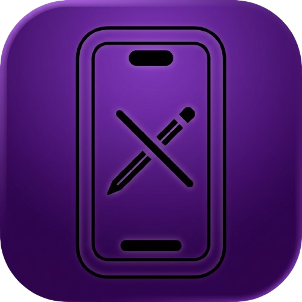

# GestaltEdit

**A MobileGestalt utility that runs directly on iPhone and iPad**

  
  
  
  
  

<a href="https://github.com/frs0n/GestaltEdit/releases/latest"><b>Download IPA</b></a> ·
<a href="#requirements">Requirements</a> ·
<a href="#install">Install</a> ·
<a href="README.zh-CN.md">简体中文</a>

Edit `com.apple.MobileGestalt.plist` on-device. Capability presets, a full field editor, and backup/restore.

> [!WARNING]
> This app uses private APIs and modifies system cache data. Bad MobileGestalt values can break system features and may require restoring the device. Use only on devices you own.

> [!IMPORTANT]
> GestaltEdit is free and its source is public. Without authorization, you may not sell it.

## Features

**Presets** — Dynamic Island, device model name, boot chime, charge limit, tap to wake, Camera Control, Apple Pencil, Action Button, Collision SOS, Always-On Display, wallpaper parallax, Stage Manager, iPad app compatibility, Siri AI US region, and more. Tick what you want, tap Apply.

**Field editor** — Search and edit any MobileGestalt key by hand when a preset doesn't cover it.

**Backups** — Every write is backed up automatically. Back up, import, export, and restore at any time.

## Requirements

- iOS / iPadOS 26.0 or later
- Developer Mode enabled
- A signing tool such as [iLoader](https://github.com/nab138/iloader)

## Install

1. Download `GestaltEdit.ipa` from [Releases](https://github.com/frs0n/GestaltEdit/releases/latest).
2. Install [iLoader](https://iloader.app/), connect your device, and sign in with your Apple ID (used only for local signing).
3. Import the IPA to sign and install it, then trust the certificate under Settings → General → VPN & Device Management.

## Apple Watch helper

Expand the connection row at the top of Tools and select the active Apple Watch paired with this iPhone. The Watch app only handles MG access: watchOS-specific presets, field editing, backup, import/export, and restore stay on the iPhone. Backups are separated by watch and from iPhone backups. Writes back up the original on both devices and verify the saved file. Selecting Watch shows a separate catalog: Hermès/Ultra watch faces, Watch display and controls, sensors/workouts, voice, a top-level combined Siri AI preset, independent region fields and Watch resolutions. iPhone/iPad presets are never applied to Watch. Face changes require a matching Watch build, CacheUUID, cache length and present slots, using the layouts from HermesEnabler. The combined Siri AI preset enables all three Watch intelligence flags. It changes MG region/sales fields to US only when the Watch reports an unsupported regional setting (mainland China or the EU), or the MG contains a mainland-China region marker; other regions are preserved. This does not change Apple Account region or location-based service eligibility.

1. Install an IPA containing both the iPhone app and `Watch/GestaltWatch.app`. Sign both apps and their respective App Groups.
2. Tap **Install Watch Helper** in the device selector and follow the instructions to install GestaltEdit from **Available Apps** in the system Watch app. If a signing tool strips Watch content, use a tool that preserves it or install the **GestaltWatch** target directly with Xcode.
3. Open GestaltEdit Helper on the watch and keep it in the foreground nearby. Select Apple Watch in the iPhone app. No MG editing or approval is required on the watch.
4. After applying changes or restoring a backup, tap **Restart Watch Interface** on the iPhone. The helper dynamically loads WebKit on the watch and runs the NeoSpring path adapted from HermesEnabler/Gester to request a Carousel restart. Missing runtime support reports an error and requires a manual watch restart. Acceptance of the request does not confirm that Carousel restarted. The iPhone does not respring for Watch writes.

The build deployment target is watchOS 26.0. Actual system access depends on the watchOS version and signing; device compatibility has not been verified. With multiple paired watches, the app uses the system's active watch; switch watches in the system Watch app.

Design reference: [HermesEnabler](https://github.com/pookjw/HermesEnabler)'s iPhone/Watch companion structure. MG access reuses GestaltEdit's own implementation. Watch keys/layout data and the dynamic Watch NeoSpring adapter are adapted under the MIT license; license notices are bundled in the apps. No physical Watch behavior has been validated.

## Credits

- [Nugget](https://github.com/leminlimez/Nugget) — presets and iPadOS support
- [FilzaSlop](https://github.com/0xjohnnydev/FilzaSlop), [worse_query](https://github.com/forcequitOS/worse_query), [0xJohnny](https://x.com/0xjohnny) — file access research
- [neospring](https://github.com/rooootdev/neospring) — respring implementation

Not affiliated with Apple or the projects above.

## License

[GNU General Public License v3.0 or later](LICENSE).
