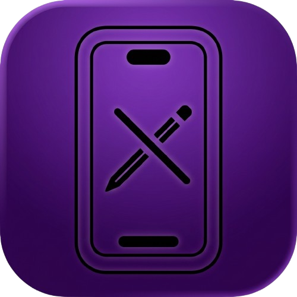

# GestaltEdit

**A MobileGestalt utility that runs directly on iPhone and iPad**

  
  
  
  
  

<a href="https://github.com/frs0n/GestaltEdit/releases/latest"><b>Download IPA</b></a> ·
<a href="#requirements">Requirements</a> ·
<a href="#install">Install</a> ·
<a href="README.zh-CN.md">简体中文</a>

Edit `com.apple.MobileGestalt.plist` on-device. Capability presets, a full field editor, and backup/restore.

> [!WARNING]
> This app uses private APIs and modifies system cache data. Bad MobileGestalt values can break system features and may require restoring the device. Use only on devices you own.

> [!IMPORTANT]
> GestaltEdit is free and its source is public. Without authorization, you may not sell it.

## Features

**Presets** — Dynamic Island, device model name, boot chime, charge limit, tap to wake, Camera Control, Apple Pencil, Action Button, Collision SOS, Always-On Display, wallpaper parallax, Stage Manager, iPad app compatibility, Siri AI US region, and more. Tick what you want, tap Apply.

**Field editor** — Search and edit any MobileGestalt key by hand when a preset doesn't cover it.

**Backups** — Every write is backed up automatically. Back up, import, export, and restore at any time.

## Requirements

- iOS / iPadOS 26.0 or later
- Developer Mode enabled
- A signing tool such as [iLoader](https://github.com/nab138/iloader)

## Install

1. Download `GestaltEdit.ipa` from [Releases](https://github.com/frs0n/GestaltEdit/releases/latest).
2. Install [iLoader](https://iloader.app/), connect your device, and sign in with your Apple ID (used only for local signing).
3. Import the IPA to sign and install it, then trust the certificate under Settings → General → VPN & Device Management.

## Credits

- [Nugget](https://github.com/leminlimez/Nugget) — presets and iPadOS support
- [FilzaSlop](https://github.com/0xjohnnydev/FilzaSlop), [worse_query](https://github.com/forcequitOS/worse_query), [0xJohnny](https://x.com/0xjohnny) — file access research
- [neospring](https://github.com/rooootdev/neospring) — respring implementation

Not affiliated with Apple or the projects above.

## License

[GNU General Public License v3.0 or later](LICENSE).
