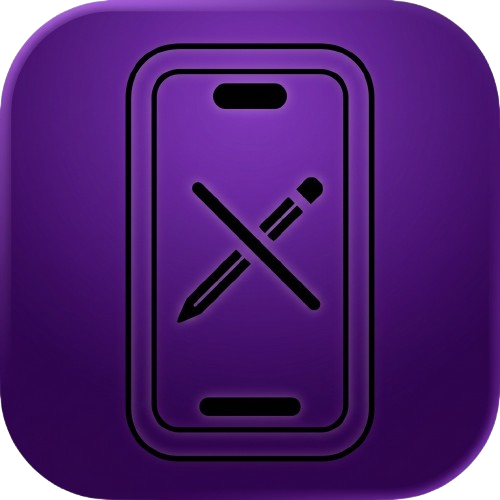

# GestaltEdit

**直接在 iPhone 和 iPad 上运行的 MobileGestalt 工具**

  
  
  
  
  

<a href="https://github.com/frs0n/GestaltEdit/releases/latest"><b>下载 IPA</b></a> ·
<a href="#系统要求">系统要求</a> ·
<a href="#安装">安装</a> ·
<a href="README.md">English</a>

在设备上直接编辑 `com.apple.MobileGestalt.plist`，提供功能预设、完整字段编辑器与备份 / 恢复。

> [!WARNING]
> 本项目使用私有 API 并修改系统缓存数据。错误的取值可能破坏系统功能，严重时需要刷机恢复。请仅在你本人拥有的设备上使用。

> [!IMPORTANT]
> 本项目免费、源码公开；未经授权，不得以任何形式出售本 App。

## 功能

**预设** —— 灵动岛、设备型号名称、开关机铃声、充电限制、轻点唤醒、相机控制、Apple Pencil、操作按钮、车祸检测、息屏显示、壁纸视差、台前调度、iPad 应用兼容性、Siri AI 美区等。勾选需要的，点「应用」。

**字段编辑器** —— 预设没覆盖到的，可以自己搜索并编辑任意 MobileGestalt 键值。

**备份** —— 每次写入都会自动备份，也可随时手动备份、导入、导出与恢复。

## 系统要求

- iOS / iPadOS 26.0 或更高版本
- 设备已开启开发者模式
- 一种签名安装方式，例如 [iLoader](https://github.com/nab138/iloader)

## 安装

1. 从 [Releases](https://github.com/frs0n/GestaltEdit/releases/latest) 下载 `GestaltEdit.ipa`。
2. 安装 [iLoader](https://iloader.app/)，连接设备并登录 Apple ID（仅用于本地签名）。
3. 导入 IPA 完成签名安装，然后在「设置」→「通用」→「VPN 与设备管理」中信任证书。

## Apple Watch 助手

在 Tools 顶部展开设备连接栏，选择当前与 iPhone 配对且启用的 Apple Watch。手表端仅作为 MG 读写助手，watchOS 专用预设、字段编辑、备份、导入导出和恢复都在 iPhone 上操作。每只手表的备份与 iPhone 备份分开保存，写入前在两端保存原始备份，写入后回读验证。选择手表后显示独立预设：Hermès / Ultra 表盘、手表显示与控制、传感器与体能训练、语音、置顶的一键 Siri AI、独立地区字段以及手表分辨率。手表不会应用 iPhone / iPad 预设。表盘修改使用 HermesEnabler 的版本表，并校验手表的系统构建号、CacheUUID、缓存长度和存在标记。一键 Siri AI 会同时启用三个手表智能能力标记；仅当手表上报不支持的地区设置（中国大陆或欧盟），或 MG 中存在中国大陆地区标记时，将 MG 地区与销售地区字段调整为美国，其余地区保留原值。这不会修改 Apple 账户地区或改变基于位置的服务资格。

1. 安装同时包含 iPhone App 和 `Watch/GestaltWatch.app` 的 IPA；两个 App 及各自的 App Group 都需要正确签名。
2. 在设备栏点按“安装手表助手”，按提示打开系统 Watch App，在“可用 App”中安装 GestaltEdit。若签名工具剥离了 Watch App，请使用保留 Watch 内容的工具或通过 Xcode 的 GestaltWatch 目标直接安装。
3. 在 Apple Watch 上打开 GestaltEdit 助手，保持助手处于前台且手表在附近，然后在 iPhone 上选择 Apple Watch。手表端无需编辑或确认 MG 修改。
4. 在 iPhone 上应用修改或恢复备份后，点按“重启手表界面”。助手会在手表本机动态加载 WebKit，运行移植自 HermesEnabler / Gester 的 NeoSpring 路径，请求重启 Carousel。运行环境不支持时会返回错误，需要手动重启手表。请求被接受不代表已确认重启成功，不会重启 iPhone 的桌面。

构建最低要求为 watchOS 26.0；系统访问能否成功仍取决于 watchOS 版本和签名，尚未验证真机兼容范围。多只配对手表使用系统当前启用的一只，可在系统 Watch App 中切换。

设计参考：[HermesEnabler](https://github.com/pookjw/HermesEnabler) 的 iPhone / Watch 伴侣结构；MG 访问复用 GestaltEdit 自身的实现。手表字段、版本数据和动态 NeoSpring 适配根据 MIT 许可移植，App 内附许可声明。尚未验证真实手表行为。

## 致谢

- [Nugget](https://github.com/leminlimez/Nugget) —— 预设与 iPadOS 支持
- [FilzaSlop](https://github.com/0xjohnnydev/FilzaSlop)、[worse_query](https://github.com/forcequitOS/worse_query)、[0xJohnny](https://x.com/0xjohnny) —— 文件访问研究
- [neospring](https://github.com/rooootdev/neospring) —— 注销实现

与 Apple 及上述项目均无隶属关系。

## 许可证

[GNU 通用公共许可证第 3 版或更高版本](LICENSE)。
